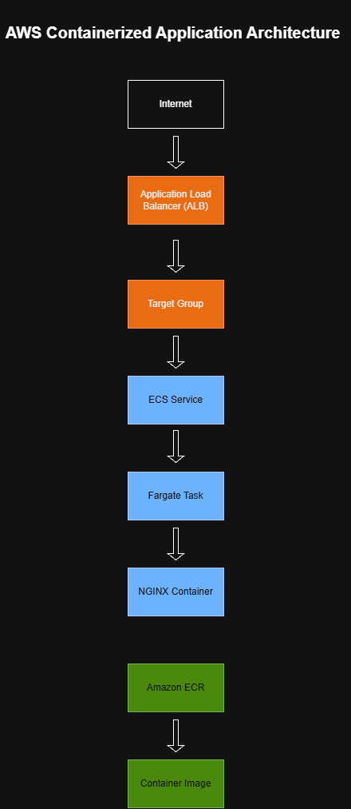
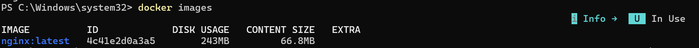
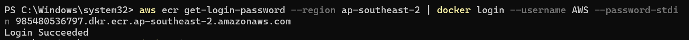
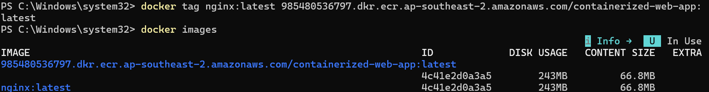
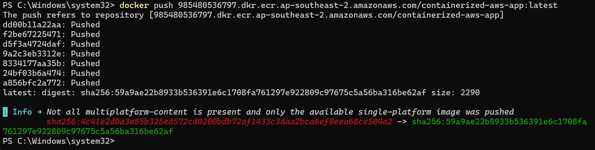
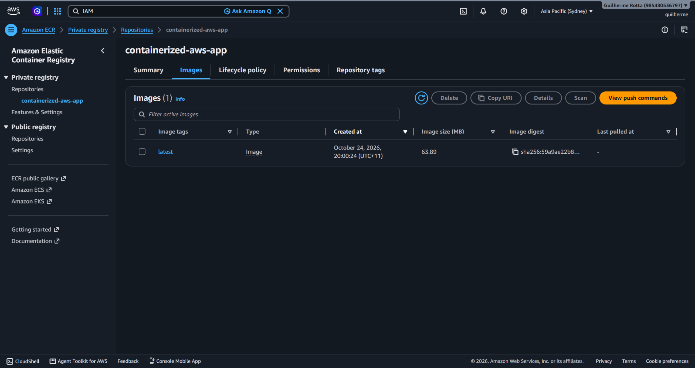
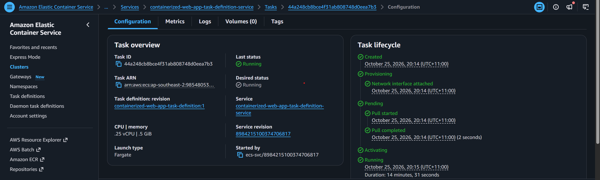
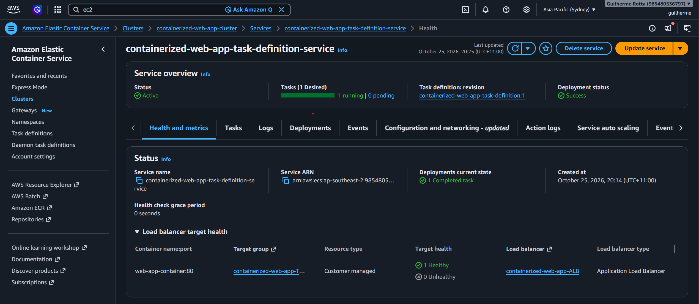

# AWS Containerized Web Application

Deploying a containerized web application on AWS using Docker, Amazon ECR, Amazon ECS, AWS Fargate and Application Load Balancer.

---

# Project Overview

This project demonstrates how to deploy a containerized web application on AWS using Docker, Amazon Elastic Container Registry (ECR), Amazon Elastic Container Service (ECS), AWS Fargate, and an Application Load Balancer (ALB).

The primary objective was to understand the complete container deployment lifecycle, from pulling a public Docker image to running a containerized workload on AWS.

---

# Architecture



The application container image is stored in Amazon ECR and deployed through Amazon ECS using AWS Fargate. Incoming requests are routed through an Application Load Balancer and forwarded to healthy tasks through a Target Group.

---

# AWS Services Used

| Service | Purpose |
|----------|----------|
| Amazon ECR | Store container images |
| Amazon ECS | Container orchestration |
| AWS Fargate | Serverless container runtime |
| Application Load Balancer | Traffic routing and health checks |
| Target Group | Health monitoring and request forwarding |
| IAM | ECS execution permissions |
| Amazon VPC | Network environment |

---

# Project Objectives

- Deploy containers without managing EC2 instances.
- Understand the Amazon ECS deployment lifecycle.
- Learn how Docker images are stored and managed in Amazon ECR.
- Configure AWS Fargate as the launch type.
- Expose the application through an Application Load Balancer.
- Implement health checks using Target Groups.

---

# Screenshots

## Container Registry Workflow

### 1. Docker Image Downloaded from Docker Hub



The official NGINX image was downloaded from Docker Hub and stored locally using Docker Desktop.

---

### 2. Amazon ECR Authentication



Docker was successfully authenticated against Amazon Elastic Container Registry (ECR) using AWS CLI credentials and IAM permissions.

---

### 3. Docker Image Retagging for ECR



The original `nginx:latest` image was retagged using the Amazon ECR repository URI. This demonstrated that multiple Docker tags can reference the same underlying image.

#### Key Learning

- Docker Images and Docker Tags are different concepts.
- Multiple tags can point to the same image.
- A tag containing the ECR repository URI is required before pushing an image to Amazon ECR.

---

### 4. Publishing the Container Image to Amazon ECR



The NGINX image was successfully pushed from the local Docker environment to Amazon ECR.

---

### 5. Container Image Stored in Amazon ECR



The image is now stored in a private Amazon ECR repository and ready to be consumed by Amazon ECS.

---

# ECS Deployment Workflow

### 6. ECS Task Running on AWS Fargate



The container was deployed using AWS Fargate with the following configuration:

```text
Launch Type: Fargate
CPU: 0.25 vCPU
Memory: 0.5 GiB
Container Port: 80
```

The task lifecycle shows the image being pulled from Amazon ECR and progressing successfully to the running state.

AWS Fargate was selected because the goal of this project was container deployment rather than infrastructure management.

Benefits:

- No EC2 administration
- No operating system maintenance
- Serverless container execution
- Reduced operational overhead

---

### 7. ECS Service Successfully Deployed



The ECS Service maintains the desired task count and continuously monitors workload health.

Deployment details:

```text
Desired Tasks: 1
Running Tasks: 1
Deployment Status: Success
Target Health: Healthy
```

The task was successfully registered in the target group and made available behind the Application Load Balancer.

---

### 8. Application Running Through the Application Load Balancer


The NGINX application was successfully accessed through the Application Load Balancer DNS endpoint.

This validates the complete deployment workflow:

```text
Docker Hub
    ↓
Docker Desktop
    ↓
Amazon ECR
    ↓
Amazon ECS
    ↓
AWS Fargate
    ↓
Target Group
    ↓
Application Load Balancer
    ↓
Browser
```

---

# Deployment Decisions

## Why AWS Fargate?

AWS Fargate was selected because the objective of the project was to focus on container deployment and orchestration rather than infrastructure management.

Compared to ECS running on EC2 instances:

```text
ECS + EC2
```

requires:

- Host management
- Capacity planning
- Operating system maintenance

While:

```text
ECS + Fargate
```

provides:

- Serverless container execution
- Simplified deployments
- Reduced operational overhead

---

## Why an Application Load Balancer?

An Application Load Balancer was used to:

- Route incoming traffic.
- Perform health checks.
- Provide a single public entry point.
- Support future scaling scenarios.

The ALB also creates an abstraction layer between users and container tasks.

Users access:

```text
ALB DNS Endpoint
```

instead of directly accessing container task IP addresses.

---

# Lessons Learned

Throughout this project I learned:

- The difference between Docker Images and Docker Tags.
- The difference between Docker Hub and Amazon ECR.
- How Docker tags can reference the same image.
- How Amazon ECR stores container images.
- How Amazon ECS retrieves images from Amazon ECR.
- How Task Definitions act as blueprints for container workloads.
- How ECS Services maintain the desired number of running tasks.
- Why AWS Fargate removes the need to manage EC2 instances.
- How Application Load Balancers and Target Groups work together.
- How containerized applications can be deployed without managing servers.

One of the most important lessons learned was understanding that:

```text
Docker Image
```

and

```text
Amazon ECR Repository
```

are independent concepts. An image must be retagged before being pushed to a target repository.

---

# Future Improvements

- Implement ECS Service Auto Scaling.
- Deploy a custom application instead of the default NGINX image.
- Configure HTTPS using AWS Certificate Manager (ACM).
- Integrate Amazon Route 53.
- Implement CI/CD using GitHub Actions.
- Provision the infrastructure using Terraform.

---

# Project Status

✅ Completed

Technologies validated:

```text
Docker
Amazon ECR
Amazon ECS
AWS Fargate
Application Load Balancer
Target Groups
IAM
```

This project successfully demonstrates the deployment of a containerized web application on AWS using Amazon ECS and AWS Fargate without managing EC2 instances.
